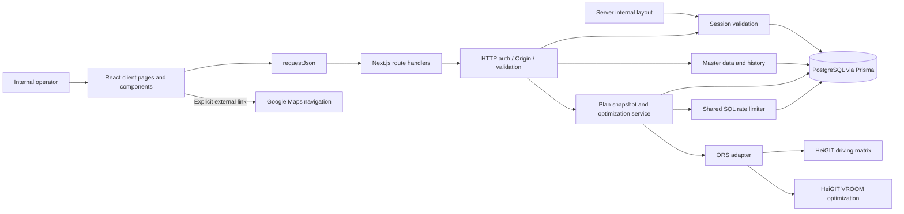
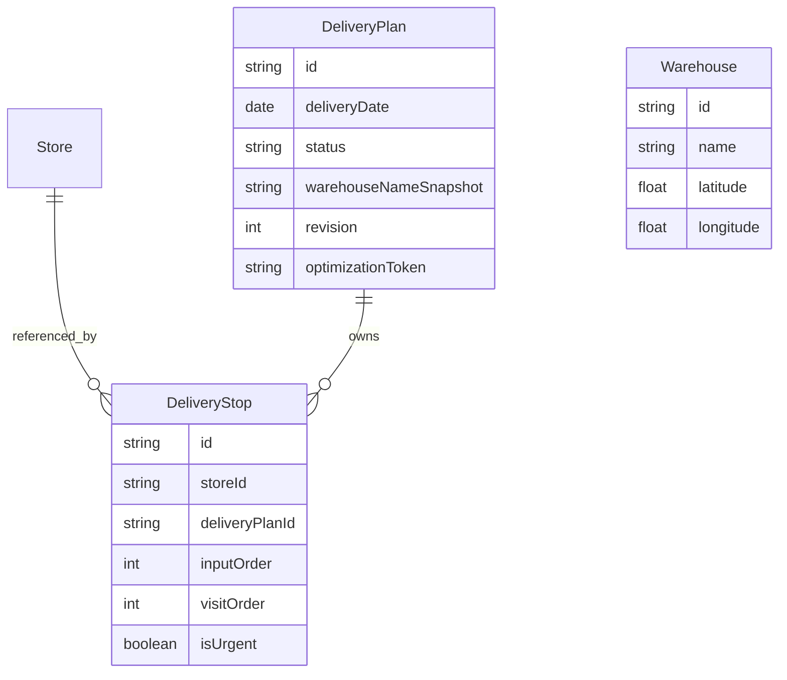
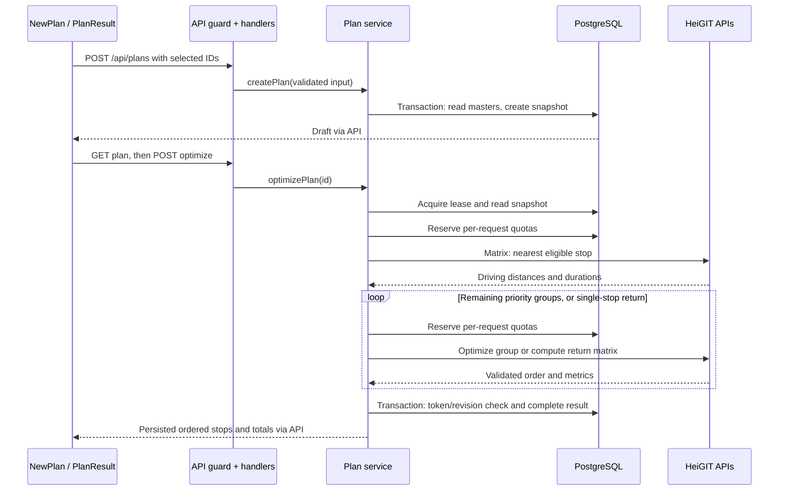

# Rute Antar — Codebase Map

Discovery date: 2026-11-02. Scope: repository source, configuration, documentation, migrations, and test implementations. This is a description of the current implementation, not a refactoring proposal.

## High-Level System Summary

Rute Antar is an Indonesian-language internal delivery-planning application for one administrator, one warehouse, and one vehicle. An operator maintains warehouse/store coordinates manually, selects 1–25 distinct active stores for a delivery date, optionally marks stops urgent, and requests a driving itinerary that returns to the warehouse. Plans preserve names, coordinates, and urgency as snapshots. Users can reopen history, explicitly recalculate a route, copy its ordered stops, and open individual destinations in Google Maps.

The application is a small layered monolith: Next.js App Router serves React pages and JSON route handlers in one deployment; Prisma accesses PostgreSQL; server-side adapters call HeiGIT/openrouteservice (ORS). Most operational pages are client components using local React state and fetch. A server layout protects internal pages, and every data endpoint independently checks authentication. There is no separate backend service, queue, repository abstraction, dependency-injection framework, or global client state store.

Routing is a constrained heuristic, not a guarantee of the globally shortest tour. A driving matrix selects the nearest eligible first stop (urgent if any); subsequent optimization stages visit remaining urgent stops before ordinary stops. A successful computation atomically replaces the saved visit order and estimates. Failed recalculation preserves the previous result. There are no capacity constraints, appointment windows, truck restrictions, live traffic, geocoding, interactive maps, delivery completion tracking, or multi-tenant boundaries.

## Discovery Evidence and Limits

- Reviewed every application/source module, all eight test files, all scripts, Prisma schema and three migrations, root configuration, README, deployment guide, and asset attribution.
- No existing `OVERVIEW.md`, docs directory, ADR collection, CI workflow, or additional nested `AGENTS.md` was found in the repository inventory.
- Initial working tree was clean. Only this discovery document was added.
- `node_modules` is absent. The required version-specific Next.js guides at `node_modules/next/dist/docs/` and generator implementation could not be inspected. Before future code changes, install locked dependencies and read the relevant local guides as required by `AGENTS.md`; preserve its generated rules block.
- No application execution, dependency installation, build, tests, database access, or external routing requests were performed. Test coverage below describes test source, not a passing execution result. External platform limits and historical audit claims in existing documentation were not independently revalidated.

## Stack, Configuration, and Entry Points

| Area | Repository configuration |
| --- | --- |
| Runtime | Node.js `>=24 <25`, npm lockfile, ESM package (`type: module`) |
| Web | Next.js `^16.4.1`, React/React DOM `^19.3.1`; manifest ranges, with resolved dependencies pinned by `package-lock.json` |
| Language | TypeScript `^6.0.3`, strict mode, ES2022 target, bundler resolution, `@/*` → `src/*` |
| UI | Tailwind CSS 4 through PostCSS, Lucide icons, adapted shadcn/Radix Button with CVA and tailwind-merge |
| Persistence | Prisma/client `^6.19.3`; PostgreSQL 17 in Compose; `pg_trgm` required by migration |
| Security/input | iron-session 9, bcryptjs 3, Zod 4 with Indonesian locale |
| Quality | ESLint 9 with Next core-web-vitals/TypeScript rules, Prettier, Vitest 5 in Node environment |
| Build | `next dev --webpack` / `next build --webpack`; standalone output; powered-by header disabled |

### Commands and deployment lifecycle

| Command | Purpose and relevant effects |
| --- | --- |
| `npm ci` | Install lockfile dependencies |
| `npm run dev` | Webpack development server |
| `npm run db:generate` | Generate Prisma Client from schema |
| `npm run db:migrate` | Apply committed migrations (`prisma migrate deploy`) |
| `npm run admin:create` | Create/update fixed admin; updating increments session version |
| `npm run build` | Production Webpack build |
| `npm start` | Load optional `.env`, copy public/static assets into standalone output, start its server |
| `npm run lint`, `npm run typecheck`, `npm test` | Static checks and Vitest suite |
| `npm run test:db` | Load required `.env`, run PostgreSQL integration file; additionally gated by `RUN_DB_TESTS=true` |
| `npm run test:http` | Authenticate against running server and check API/security behavior |
| `npm run format` | Write Prettier formatting to `src`, `tests`, `scripts`, README |

`Dockerfile` has base/build/runner stages using Node 24 Debian slim plus OpenSSL. The runner copies standalone output and assets and runs as a non-root user. Compose starts PostgreSQL with a persistent `database` volume, waits for its health check, runs migrations/admin setup, then starts the app. Both published ports bind to loopback. Re-running setup resets the configured admin password and invalidates older sessions.

`DEPLOYMENT.md` describes Vercel plus a separate hosted PostgreSQL database, Prisma generation during build, and out-of-band migrations/admin initialization. The schema reads only `DATABASE_URL`; merely adding `DIRECT_URL` does not configure a migration connection. Local `scripts/start.mjs` binds to `APP_HOST` or `127.0.0.1`; Docker instead runs `server.js` with `HOSTNAME=0.0.0.0`.

### Environment contract

| Variable | Consumer/purpose |
| --- | --- |
| `DATABASE_URL` | Prisma PostgreSQL connection |
| `SESSION_SECRET` | Session encryption password; at least 32 characters |
| `APP_URL` | Expected request origin and HTTPS-based Secure-cookie decision |
| `ORS_API_KEY` | Server-only Authorization header for both ORS APIs |
| `ADMIN_USERNAME`, `ADMIN_PASSWORD` | Admin setup and authenticated HTTP smoke script |
| `POSTGRES_USER`, `POSTGRES_PASSWORD`, `POSTGRES_DB`, `DB_PORT` | Compose database configuration; Compose overrides app/setup connection hostname to `db` |
| `APP_HOST` | Optional local standalone bind address |
| `RUN_DB_TESTS` | Opt-in integration test gate |

Secrets have no `NEXT_PUBLIC_` prefix. `.env.example` is a sanitized template; `.gitignore` excludes local secrets and generated artifacts. `.dockerignore` excludes local secrets, dependencies, generated outputs, and common agent/editor state. No centralized startup configuration validator exists; most settings are checked when their consumer runs.

## Directory-by-Directory Breakdown

| Path | Responsibilities and collaborators |
| --- | --- |
| `src/app/` | App Router entry points; root metadata/Indonesian HTML language, global styles, root redirect, login and public policy pages |
| `src/app/(internal)/` | Authenticated, force-dynamic layout wrapping `Shell`; loading/error boundaries and operational client pages. Parenthesized group is not part of URLs |
| `src/app/api/` | Thin JSON HTTP handlers; all use `lib/http.api`; direct Prisma for simple CRUD, `lib/plans` for workflows |
| `src/components/` | Shared page chrome, location editor, plan results, notices and pagination; imports browser DTO/fetch helpers and presentation utilities |
| `src/components/ui/` | Single adapted Radix/shadcn Button primitive with variants and `asChild` support |
| `src/lib/` | Validation, browser contracts, database singleton, sessions, HTTP guard, rate limiter, plan orchestration, ORS adapter, formatting |
| `prisma/` | Current schema and ordered PostgreSQL migrations; schema alone does not capture all SQL constraints/indexes |
| `scripts/` | Standalone startup, admin provisioning, HTTP smoke, explicit real-provider smoke |
| `tests/` | Vitest validation, security, route-adapter, workflow, history, and opt-in database coverage |
| `public/` | Google Maps attribution SVG and provenance; retained for legacy stored results |
| Root docs/config | README (domain/operations), DEPLOYMENT (Vercel), AGENTS (Next guidance), package/lock, Docker, lint/style/type/test configuration |
| `.agent/` | This discovery map; not an application runtime module |

### Library responsibilities

| Module | Important functions/contracts |
| --- | --- |
| `client.ts` | `requestJson<T>` and hand-maintained `Store`, `Warehouse`, `Stop`, `Plan`, `Optimization`, `PageData<T>` types; fetches no-store, throws API error, full navigation on protected 401 |
| `db.ts` | PrismaClient instance; caches on `globalThis` outside production to tolerate development reloads |
| `session.ts` | `getSession`, `requireAdmin`; encrypted cookie and DB-backed session-version validation |
| `http.ts` | `api`, `json`, `readJson`, `checkOrigin`; central auth/origin/error envelope and 16 KiB streamed JSON limit |
| `errors.ts` | `AppError` carrying a public message and HTTP status (default 400) |
| `validation.ts` | Location/store/login/paging/plan Zod schemas; coordinate coercion and urgent-subset validation |
| `plans.ts` | `createPlan` snapshots and `optimizePlan` lease, staged routing, quotas, deadline and atomic persistence |
| `ors-routes.ts` | `computeRoute`, `computeDrivingLegs`, permutation validation, provider payload/response handling; injectable fetcher for tests |
| `rate-limit.ts` | Atomic PostgreSQL upsert counters shared across instances |
| `utils.ts` | Class merging, Jakarta date default/formatting, single-destination Google navigation URL |

### UI modules and user journeys

| URL/component | Behavior |
| --- | --- |
| `/` | Redirects to `/plans/new` |
| `/login` | Credentials form; successful login uses a full navigation to discard prior router cache |
| `/warehouse` | Loads singleton or null; shared `LocationForm` submits warehouse upsert |
| `/stores` | Search all active/inactive stores, paginate, create/edit, confirm soft deactivation; external location link |
| `/plans/new` | Load warehouse and active stores; select across result pages, mark urgency, choose Jakarta-default date; create draft, fetch it, optimize |
| `/plans/[id]` | Fetch stored snapshot; render `PlanResult`; never automatically recompute |
| `/history` | Paginated plan summaries, latest delivery date first, links to detail |
| `/terms`, `/privacy` | Public server-rendered informational pages; no login requirement |
| `Shell` | Responsive navigation, active pathname indication, logout, policy links |
| `LocationForm` | Uncontrolled inputs via FormData; manual coordinates, optional store address; server performs authoritative validation |
| `PlanResult` | Saved/current result, explicit retry/recalculation, urgent labels, estimates, provider attribution, clipboard text and navigation links |
| `common.tsx` | Page titles, accessible alert/status notices, fixed-20-item pagination |

State lives in component `useState`; effects fetch lists/details, and store searches debounce by 200 ms. Effect cleanup uses an `active` flag to ignore stale responses rather than aborting the network request. Store mutations increment a local version to reload the list. Plan submission/recalculation also use a `useRef` lock to reject immediate duplicate clicks. No Redux, Zustand, React Query, SWR, context store, or server actions are present.

## Architecture Diagram

There is no provider call while selecting stores or reopening history. Searching does call the application's own store API; statements in README about no API calls while typing refer to routing-provider calls, not all HTTP requests.

## Data Layer and Invariants

| Model | Data and relationships |
| --- | --- |
| `Warehouse` | Singleton `main`, name and coordinates; copied into plans, no plan foreign key |
| `Store` | CUID, name, optional address, coordinates, active flag, timestamps; referenced by stops; deactivation preserves references |
| `DeliveryPlan` | CUID, PostgreSQL date, DRAFT/OPTIMIZED status, warehouse snapshot, nullable metrics/provider/calculation time, lease token/start and revision; owns stops |
| `DeliveryStop` | CUID, plan/store FKs, store name/coordinate snapshot, zero-based input order, nullable one-based visit order, per-plan `isUrgent` |
| `Admin` | Application uses fixed ID `admin`, unique username, bcrypt hash, sessionVersion; schema does not enforce a singleton ID check |
| `RateLimit` | String key, windowStart, count; no user/IP relation |

Migration details that future work must preserve:

- `202610150001_initial`: base tables, status enum, FKs, warehouse singleton CHECK, coordinate CHECKs on masters and snapshots, inputOrder 0–24 / visitOrder 1–25 CHECK, unique `(deliveryPlanId, storeId)` and `(deliveryPlanId, inputOrder)`, `pg_trgm` extension and GIN name-search index.
- Store FK restricts hard deletion when referenced; deleting a plan cascades stops. No API exposes plan deletion or store hard deletion.
- B-tree indexes cover Store `(isActive, name, id)` and DeliveryPlan `(deliveryDate, id)`.
- `20261028000000_ors_results`: nullable distance/duration/provider; marks previously optimized plans `GOOGLE_LEGACY`; nonnegative finite metric CHECKs. Legacy orders remain valid without invented estimates.
- `20261030000000_urgent_stops`: non-null `isUrgent`, default false for old records.
- There is no unique visitOrder constraint. Complete permutations and urgent precedence are enforced by orchestration before the transaction.
- Store names/coordinates need not be unique across master records. The duplicate-store prohibition applies to IDs within a plan.
- Plan date is validated as an ISO calendar date, without a future-only restriction. Address is a master-data note, not a plan snapshot or provider input.

## HTTP Surface

All JSON responses produced by the shared helper use `Cache-Control: no-store, private`. All endpoints except login require a valid admin session; login still checks Origin. Dynamic route params are Promises, awaited in handlers and unwrapped with React `use` in the client detail page.

| Method/path | Input → output / action |
| --- | --- |
| `POST /api/login` | Username/password → `{ok:true}` and session cookie; global 10 attempts/300 seconds |
| `POST /api/logout` | Destroy cookie session → `{ok:true}` |
| `GET /api/warehouse` | Singleton object or null |
| `PUT /api/warehouse` | Name/coordinates → upserted singleton |
| `GET /api/stores` | `q`, `page`, optional `active=true` → `{items,total,page}`; case-insensitive name substring, name/ID ascending |
| `POST /api/stores` | Name/address/coordinates → new active store (201) |
| `PUT /api/stores/[id]` | Name/address/coordinates → updated store; does not reactivate |
| `DELETE /api/stores/[id]` | Set `isActive=false`; returns updated record |
| `GET /api/plans` | Page → selected summary fields and stop count; deliveryDate/ID descending |
| `POST /api/plans` | Date, unique storeIds, optional urgentStoreIds → persisted draft fields (201), without included stops |
| `GET /api/plans/[id]` | Full plan with stops in inputOrder; 404 for missing plan |
| `POST /api/plans/[id]/optimize` | No body required → indices, ordered stops, meters, seconds, `persisted:true`, ORS provider and timestamp |

Lists use offset pagination with 20 items and a separate count in a Prisma transaction. Page range is 1–100000; search length at most 120. Only literal `active=true` filters stores; `active=false` does not request inactive-only records.

## Data & Request Flow

### Primary journey: create and optimize a delivery plan

1. The internal server layout calls `requireAdmin`; failures redirect to login. Client pages then call independently protected JSON endpoints.
2. `/plans/new` fetches warehouse and paginated active stores. Selection and urgency stay local until submission. Removing a selected store also removes its urgency marker.
3. The client POSTs `{deliveryDate, storeIds, urgentStoreIds}`. `api()` validates the session, checks Origin, and delegates. `readJson()` enforces a 16 KiB streaming limit; Zod enforces date, count, uniqueness, and urgent subset rules.
4. `createPlan()` opens a transaction, reads warehouse `main`, fetches all selected active stores, and rejects missing/inactive IDs. It sorts the fetched stores by ID ascending, then creates the plan and nested stop snapshots. **Stored inputOrder is this ID order, not browser selection order.**
5. The client GETs the new plan including stops, then explicitly POSTs its optimize endpoint. Creating a plan by itself never calls ORS.
6. `optimizePlan()` starts a 50-second deadline and atomically acquires a UUID lease if no token exists or its start is older than 60 seconds. Missing or currently leased plans both return 409. It reads immutable snapshot coordinates and stops in input order.
7. Before each routing request, it reserves global minute and daily quota via separate atomic SQL upserts. It calls the matrix API from warehouse to all urgent stops, or all stops when none are urgent.
8. It chooses the first stop by driving distance, then duration, then stored input order for exact ties. Null/unreachable cells or malformed matrix dimensions reject the computation.
9. It removes that stop from the urgent/normal groups. Remaining urgent stops are optimized first; if normal stops remain, this stage has an open end. The next stage starts at the last returned urgent stop, visits normal stops, and ends at the warehouse. With only one remaining group, that group returns directly to the warehouse. With one total stop, a second matrix request computes its separate return leg.
10. The service totals outbound and subsequent-stage metrics, validates that all stops appear exactly once and urgent stops come first, and checks the deadline. No network request occurs inside a DB transaction.
11. In a transaction with a 5-second timeout, a conditional plan update matches ID, token, and original revision. It writes metrics/provider/time/status, increments revision, clears the lease, and updates every stop's one-based visitOrder. Any failure rolls back the result changes.
12. The response populates `PlanResult`. Finally, token-scoped cleanup releases any remaining lease. Failures leave prior saved order/metrics intact; an initial failure leaves a retryable draft. Reopening history reads persisted results without provider calls.

Successful computations use **two ORS calls** for a single stop, all-urgent/all-normal plans, or one urgent plus normal stops; **three calls** when both normal stops and additional urgent stops remain after selecting the first urgent stop. Failures can terminate earlier.

### Authentication and master-data changes

Login checks Origin, consumes the global login counter, validates input, loads fixed admin `admin`, compares bcrypt password and username, then saves admin ID/version in the encrypted cookie. Every authenticated request subsequently loads the admin from PostgreSQL and compares the stored session version. Provisioning a new password invalidates existing sessions by incrementing that version.

Warehouse/store forms send string coordinate values through FormData-derived JSON. Zod converts nonempty numeric strings and rejects blanks, booleans, non-finite values, and out-of-range coordinates; zero is valid. Master writes affect future snapshots only. Recalculating an older plan continues to use its original coordinates even if a store is now inactive.

## Key Constraints & Conventions

### Security, errors, and caching

- Cookie name `rute-antar-session`; encrypted session TTL 8 hours, HttpOnly, SameSite=Lax, root path; Secure enabled when `APP_URL` starts with HTTPS.
- Mutations require exact `Origin === new URL(APP_URL).origin`; missing Origin is rejected. Non-browser callers must explicitly supply it. There is no separate CSRF token or permissive CORS configuration.
- Authentication precedes Origin/business logic except for unauthenticated login. The internal layout is not the sole security boundary.
- `AppError` messages/statuses are exposed; Zod exposes the first issue as 400; all other exceptions become a generic Indonesian 500 response. Provider responses and secrets are not forwarded verbatim.
- No structured application logger, audit trail, tracing, monitoring integration, or dedicated health endpoint exists. Unexpected API exceptions are swallowed into the generic envelope without logging.
- Full browser navigation after login/logout/session expiry intentionally clears protected router cache; retain the reason behind the targeted ESLint suppressions.

### Domain and provider boundaries

- One warehouse and vehicle; 1–25 unique stores; all urgent stops before normal; immutable input snapshots; no in-place plan editing endpoint.
- UI “change selection / create new plan” returns to the editor and a subsequent submit creates a new record. It does not mutate or remove the earlier plan.
- ORS coordinates use `[longitude, latitude]`; app objects use named latitude/longitude. Job IDs are one-based within each submitted group and map back to zero-based indices.
- Matrix endpoint is `https://api.heigit.org/openrouteservice/v2/matrix/driving-car`; optimization endpoint is `https://api.heigit.org/vroom/v0` with `driving-car` and `options.g=true`. Geometry and raw responses are discarded.
- No fallback to straight-line distance or another provider, and no automatic retries. Per-request timeout is 20 seconds combined with the overall deadline.
- Names, addresses, and credentials are not sent to ORS; coordinates are. Google links open one destination at a time without an API key.
- Preserve legacy provider attribution and nullable estimates; loading history must not silently recalculate or invent numbers.

### Code and presentation conventions

- Components use PascalCase, functions camelCase, shared files generally kebab-case, App Router conventional `page.tsx`/`route.ts`/`layout.tsx` filenames. Tables/models use Prisma PascalCase and fields camelCase.
- TypeScript is strict; use `@/` for cross-directory imports. Browser DTOs are handwritten rather than generated from API schemas.
- Indonesian labels/errors, `id-ID` display formatting, Asia/Jakarta dates/timestamps; default date comes from `jakartaToday()` rather than host UTC date.
- `inputOrder` is zero-based, `visitOrder` one-based; distances are meters and durations seconds internally, formatted as km and rounded-up minutes in UI.
- Use shared Button/Notice/LocationForm and global `.panel`/`.field` styles; Tailwind 4 CSS import/theme, no classic Tailwind config file. `components.json` declares a hooks alias but there is no hooks directory currently.
- Webpack is an intentional Windows CSS-worker workaround documented in README. Do not assume switching bundlers is incidental cleanup.

## Multi-Perspective Findings and Known Edges

### Architect perspective

- Boundaries are pragmatic: route handlers own simple CRUD, `plans.ts` owns the main business workflow, and the ORS adapter owns wire validation. Database constraints supplement application rules.
- DB leases and rate counters work across app instances, but every protected request incurs an admin lookup and routing operations require repeated DB writes. Each process has its own production Prisma client/pool; connection budgets matter when scaling deployments.
- Long synchronous routing requests occupy the web runtime. No durable jobs, progress polling, automatic retry, or recovery worker exists; a terminated request's lease becomes reclaimable by expiry.
- Global limits are intentionally shared: 5 ORS requests/60 seconds and 100/86400 seconds, counted per attempted stage, not per completed plan. Multiple simultaneous plans can exhaust quota midway through a computation. Minute/daily reservations are separate writes; a later rejection does not roll back an earlier reservation.
- RateLimit implements windows measured from the last reset, not a rolling-window algorithm or calendar-day reset. Requests over the threshold still increment the counter.
- Offset pagination/count queries and unbounded plan history can become expensive as data grows. Existing indexes help, but there is no retention job or archival tier.
- Snapshot duplication trades storage for historical stability. Sequential stop updates inside a 5-second transaction are currently bounded by 25 stops.

### Developer perspective: observed debt and caveats

- Deployment guide still describes mixed routes as two sequential requests. Current orchestration may use three, subject to the shared 50-second deadline. README's earlier single-VROOM description is superseded by its urgent section and current code.
- `scripts/urgent-ors-smoke.ts` calls two VROOM stages directly; it does **not** exercise nearest-first matrix selection, leases, persistence, or application quotas. Running it uses real provider quota and bypasses `consumeLimit`.
- SQL-only CHECKs and the trigram index are absent from Prisma schema declarations. Preserve migrations; schema-only reconstruction is incomplete.
- `createPlan` normalizes input order to store ID order. Any future change affects nearest-stop tie-breaking and draft ordering and must be deliberate.
- Store update/deactivate on a missing ID yields Prisma's generic 500 via the wrapper, whereas missing plan GET explicitly returns 404. Missing optimize IDs and active leases intentionally share 409.
- Browser types assert JSON shape without runtime validation. `HistoryPlan` claims more fields than the summary endpoint selects, although the current page only uses returned fields.
- Draft creation is not idempotent across requests. If creation succeeds but the subsequent GET fails, the editor has no completed plan object and retrying submission can create another draft. The local click lock only covers one mounted UI instance.
- Cleanup DB failure in `optimizePlan`'s `finally` can override an earlier result/error; persisted success could therefore be reported as a request failure. No runtime reproduction was performed.
- The 50-second abort signal cancels provider fetches, not all Prisma operations; DB calls may extend wall time. The lease is acquired once, not periodically renewed.
- All internal-layout auth errors, including infrastructure/configuration errors, redirect to login. Broad error sanitization can make diagnosis difficult without external logs.
- Admin setup checks minimum password length in JavaScript characters and maximum in UTF-8 bytes; login schema caps characters, so the exact validation units differ. Setup also lacks the login schema's username trim/length rules.
- No reactivation API, plan deletion API, registration, role separation, password-reset UI, or data-retention workflow exists.

### Product/domain perspective

The application supports planning and handoff, not fleet execution. “Urgent” is a boolean ordering priority rather than a promised arrival time. Nearest-first and independently optimized groups can lengthen the overall route. Driving estimates omit unloading, breaks, and live traffic; the car profile does not enforce truck dimensions. A driver/operator still reviews route suitability. All goods are assumed to fit and stores are assumed available at any visit time. Public policy pages use generic operator language that deployment documentation asks operators to customize.

## Testing Map and Verification Strategy

| File | What the existing tests exercise |
| --- | --- |
| `tests/validation.test.ts` | Coordinate coercion/bounds/zero/blanks, unique 1–25 destinations, impossible dates |
| `tests/urgent.test.ts` | Default empty urgency and valid/invalid urgent subsets |
| `tests/ors-routes.test.ts` | VROOM payload, coordinate order, 1/25 stops, permutations, incomplete routes, errors, no retries, open/fixed endpoints |
| `tests/ors-matrix.test.ts` | Matrix payload/dimensions/metrics, malformed/unreachable results, sanitized failures, deadlines/cancellation |
| `tests/plans.test.ts` | Mocked lease conflicts/stale revision, atomic result intent, failures preserving prior results, staged urgency, nearest/tie rules, asymmetric return, overall deadline |
| `tests/plan-history.test.ts` | Stored ORS/legacy fields returned without manufactured estimates; HTTP wrapper mocked |
| `tests/security.test.ts` | Unauthenticated data endpoints, cross-origin mutation rejection, oversized/malformed body; session function mocked |
| `tests/postgres.integration.test.ts` | Opt-in real DB snapshot invariants, urgent persistence, optimization with mocked fetch, failed recalculation preservation, duplicate stop and inactive-store rejection |

Vitest uses Node, the `@` alias, and mock clearing. Most tests do not require a live provider. There are no browser/component-rendering tests or CI workflow in this checkout, and mocked lease tests do not establish production concurrency performance.

The DB integration test must target a dedicated database: it deletes optimization rate counters, temporarily overwrites the singleton warehouse, creates/deletes fixtures, restores warehouse data, and leaves newly consumed limiter counts. The HTTP smoke writes session/limiter state but no business records; it checks anonymous denial, login, list reads/no-store, rejected cross-origin write, and logout. It is not a browser end-to-end test.

For future implementation work, first restore dependencies/read bundled Next guides, then use the repository lint/typecheck/unit/build commands. Run DB/HTTP/live-provider checks only when their prerequisites and side effects are appropriate. This discovery task made no runtime validation claims and changed no application behavior.
